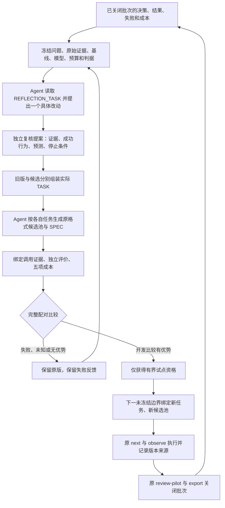

# Harness 反思与改进闭环

**2026-10-17 v2 可选规则（计划中写 `decision_rule` 才生效；不写则完全按下文 v1 规则，旧轮次、旧 REVIEW 与旧哈希不变）。** 依据 2026-10-16 证据包：1,277 份方法报告、2,554 个候选、0 次换版；harness 本身尚未有真实轮次。声明 `decision_rule: {rule: paired_sign_wilson_v1}` 后：①配对比较改为按案例计胜负的符号检验，Wilson 下界须大于 1/2，开发轮至少 16 个配对案例（试点 8 个），只对事前声明的关键判据保留一票否决；②每轮候选上限 2→4、案例上限 12→60；③候选版本包新写入证券代码或具体日期即拒绝；④复核者模型家族与生成者是否相同会被记录（`critic_independence`），**不阻止**；⑤成本未知不阻止开发轮获得试点资格，但任何已测得的单次成本超出冻结预算即拒绝，前瞻试点必须成本完整才能判为支持，并用 [计时工具](harness/v2运行说明.md#计时) 实测。理由与证据见 harness-v2/CHANGES.md。

**2026-10-17 吸收的论文做法（理由见 harness-v2/CHANGES.md）。** 不改判定、默认就有的三项：REVIEW 记录每个案例中各版本通过与未通过的判据（`case_matrix`）；下一轮 REFLECTION_TASK 附上历次候选的完整谱系（`lineage`，含提案、版本包、改动组件、测得效果、拒绝原因和体积变化；Meta-Harness 发现摘要会丢掉诊断细节）、同一案例一通过一失败的对照和跨案例反复失败的判据（`contrast`，Harness² 与 ModularRSI 的对比诊断），以及最近三轮改动都没测得收益的组件（`prune_hints`，RRSI 的剪枝；只是提示）。只在 v2 `decision_rule` 下生效的三项：①比父本严格更短的版本包（`bundle_size`：两段提示词、生成问题与单项上下文预算的字符数）不必证明增益，只需逐案例比较的负案例占比 Wilson 上界不超过 `max_simplification_loss_share`（默认 0.2：16 个案例须零负，30 个案例最多 2 负），且无关键判据退化；②多个候选同等时优先更短的版本包；③独立复核多两项判断：`task_agnostic`（不写具体案例、证券、数值或答案）与 `no_inert_addition`（新增文字都会改变行为），并允许预测 `{metric: bundle_size, direction: decrease}`。

2026-10-15，接口 `research_harness.v1`。这是结构／旧 ML 调度的可选维护入口；接入其他线须适配本线消费者，不能仅凭这份文档宣称接通。

当前 Agent 根据证据修改版本包，Python 组装实际任务、校验生成物、比较结果并冻结下一批绑定。原 `next → observe → review-pilot → export` 继续执行。代码不另启模型、不付费调用、不提交实验、不恢复任何研究线，也不改已有冻结 ENGINE、PLAN、SPEC、批次或经济评分器。

## 1. 闭环中谁做什么



Agent 不应只写“加强反思”。须回答：原判断及证据、反例和竞争解释、哪个具体方法步骤出错、哪些成功行为必须保留、改动如何改变下一次行为、预期改善什么、什么观察会证伪或触发回退。没有可支持的方法改动时保留原方法，不为凑候选重复实验。

运行入口是 [research_scheduler.py](../engine/research_scheduler.py)；新增逻辑在 [research_harness.py](../engine/research_harness.py)。[默认版本包](../engine/research_harness_default.json)是新试点的明确起点，**不代表复原了历史 Agent 的全部提示词**。需要旧版对照时，先把实际旧指令和组织方式如实固化为基线，不能拿新模板冒充旧行为。模板的 `branch` 为 `structure`；旧 ML 使用另存的 `ml` 版本，不原地改模板或他线输入。

## 2. 开放的修改面

| 组件 | 实际作用 | 约束 |
| --- | --- | --- |
| `prompts` | 反思指令和生成指令进入每次 TASK；选用的反思指令也进入下一轮 REFLECTION_TASK | 两个固定槽位，每项非空、最多 16000 字符；不能覆盖固定执行约束 |
| `generation` | Agent 收到必须考虑的问题；生成池按候选上限检查 | `questions` 为 1—12 项；`max_candidates` 为 1—8；`min_families` 为 1—候选上限。不足机制族必须给真实缺口和补充动作 |
| `context` | 按声明顺序组装真实原件摘录、路径、SHA 和行号 | `goal/evidence/failures/successes/unknowns` 五节全部保留；单项摘录 128—12000 字符；截断明示，完整引用保留 |

每轮最多两项候选（声明 v2 `decision_rule` 时最多四项），每项只改一个组件，全部候选在任何一次评价任务准备前冻结；拒绝项也占名额且不删除。变更后采用新文件和新 SHA。Python 不接受任意候选代码、评分器、执行授权或交易表达字段。`cycle --rrsi` 原有的 `priority/max_depth` 修改仍是另一条入口，不能与 harness 试点同时改动。

**泄漏检查（仅 v2 `decision_rule`）。** 候选版本包中新增的提示词或生成问题若写入证券代码（如 600519、sz000001、600519.XSHG）或具体日期（2024-02-05、20240205、2024年2月），提案记 `accepted=false` 并在 `leakage` 列出位置，不进入评价。年份本身（“2023 年验证段”）和普通数字不算。harness 改动只能改变方法，不能把某批任务的答案写进下一版指令（RRSI 的 leakage critic 思路）。

`TASK.instructions` 是 Agent 必须实际使用的任务输入；`generation` 接口要求原始回复、调用／执行证据及生成池绑定该 TASK。程序校验结构和来源，不会代替 Agent 写候选，也不会只看到“我用了新版”就将其当作效果证明。文件哈希不能证明模型调用和独立复核的真实性，原调用记录与复核过程须如实保留。

## 3. 冻结一轮比较

在原 PLAN 绑定方法问题、授权、版本与预算；引用原证据，不复制大日志。准备一个 `research_harness_plan.v1` JSON：

| 字段 | 内容 |
| --- | --- |
| `schema / branch` | `research_harness_plan.v1`；`structure` 或 `ml` |
| `kind` | `synthetic`、`development` 或 `prospective_pilot` |
| `protocol / evidence` | 原方法计划引用；非空反思证据引用列表 |
| `incumbent` | 当前 harness 版本包引用 |
| `agent_model` | 实际模型身份，两组固定一致；不是切换模型的指令 |
| `limits` | `context_chars` 1000—120000；`resource_seconds` 正数；`candidates` 1—2（v2 规则下 1—4） |
| `decision_rule`（可选） | 不写即 v1 规则。写 `{rule: paired_sign_wilson_v1, min_cases, confidence, critical_checks, max_unpaired_share, cost_tolerance}` 启用 v2；缺省为开发 16 案例、试点 8、合成 1，置信 0.9，未配对上限 20%，成本容忍 0；真实轮次不能调低案例下限；试点必须沿用开发轮的同一规则 |
| `cost_contract` | 原 `research_cost_contract.v1` 引用 |
| `selector` | 原选择器的 `rule`；若为 `bottleneck_evidence_cost_v1`，同时绑定原 `selection_contract` |
| `cases` | v1：1—12 项；v2：开发轮 16—60 项、前瞻试点 8—60 项、合成 1—60 项；分别为 `{input: CASE引用, evaluation_contract: 阶段合同引用}`；案例从台账中的历史状态快照取，每案例第一项 `evidence` 建议放该时点的[本线状态摘要](harness/v2运行说明.md#本线状态摘要) |
| `previous_review`（可选） | 上次 harness REVIEW，下一基线必须等于其 `next_harness` |
| `execution_feedback`（可选） | 已关闭执行批次的 PILOT_REVIEW；其实际 D/O 证据必须进入本轮 `evidence`，基线遵循其 `next_harness` |
| `pilot_offer`（前瞻必填） | 开发轮给出的试点资格 REVIEW；候选由该报告锁定，不再修改 |

引用一律 `{ "path": "原件绝对路径", "sha256": "原件真实SHA256" }`。不要使用占位哈希。公共输入、SPEC 和来源只引用；每轮仅冻结 ENGINE 与 HARNESS 两份小程序，旧的单文件 ENGINE 继续独立使用。

CASE 格式：

```json
{
  "schema": "research_harness_case.v1",
  "branch": "structure",
  "id": "problem_01",
  "question": "本问题要区分哪些机制？",
  "context": [
    {"id": "goal", "section": "goal", "source": {"path": "目标原件绝对路径", "sha256": "真实SHA256"}, "lines": [1, 8]},
    {"id": "failure", "section": "failures", "source": {"path": "失败原件绝对路径", "sha256": "真实SHA256"}, "lines": [10, 30]}
  ]
}
```

每个 CASE 最多 40 项上下文，必须包含 goal；原件为不超过 2 MB 的 UTF-8 文本或事先保留来源的小摘录。行号从 1 开始。没有提供某节时明示未知。总任务超出冻结字符预算直接拒绝，不静默丢弃失败或成功证据。

每个评价合同沿用 `research_stage_evaluation.v1`，`questions` 仅包含对应 CASE ID，冻结信息／工程判据及独立核验要求。冻结前选择能够区分方法优劣的实质判据，例如能否区分指定竞争解释、能否保留关键成功机制；字段齐全本身不能代替这些判断。实际生成阶段不能填经济分数。

```powershell
python -X utf8 -B engine/research_scheduler.py harness-init --spec '计划绝对路径' --out '新的本轮目录'
```

这会写 `CONTRACT.json`、`REFLECTION_TASK.json`、`ENGINE.py`、`HARNESS.py`。后续都用**本轮冻结 ENGINE**：

```powershell
python -X utf8 -B '本轮目录/ENGINE.py' harness --round '本轮目录' --request '操作请求JSON绝对路径'
```

冻结模型、原始信息和每次预算保持一致。资源秒数是实际活动成本；本入口核验回执和预算结果，不能替代现有执行器的超时控制。采用同一 Agent 时，两组输入隔离，不把另一组输出加入 CASE；需要另一个模型、付费执行或外部服务时继续按原授权边界处理。

## 4. 操作请求与真实生成物

| `operation` | 请求中的其他字段 | 结果 |
| --- | --- | --- |
| `propose` | `proposal` 与 `review` 两个引用 | 保留候选和独立复核；通过才可评价 |
| `prepare` | `bundle`、`case` 引用；默认 `purpose=evaluation` | 返回实际 `instructions` 和 TASK 引用 |
| `generation` | `task`、`response` 引用 | 校验 Agent 输出并保存 GENERATION，引用实际 FRONTIER |
| `result` | `task`、`status`、非空 `evidence`；完成时带 `generation/stage_evidence`；成本见下节 | 保存不可覆盖的 RESULT |
| `review` | 可附 `evolution_cost_receipt` | 核对全部配对结果，保存 REVIEW；该轮评价关闭 |

提案 `research_harness_proposal.v1` 绑定 `parent`、`reflection_task`、`evidence`、`bundle`、`component`，并写非空 `diagnosis / alternative_explanation / preserve / stop_rule`。`expected_effect` 当前支持 `{metric: passed_checks, direction: increase}` 或 `{metric: total_seconds, direction: decrease}`，用来核对预测而非自报成功。

独立复核 `research_harness_critic.v1`（或 v2，多一个 `verifier_model` 字段）绑定 `proposal`、本轮 `contract`、非空 `evidence`、`verifier` 和 `independent=true`；`checks` 恰为四个布尔项：`evidence_grounded / bounded_change / preserves_success / testable_prediction`；v2 规则下为六项，另加 `task_agnostic / no_inert_addition`。须实际复核，不用程序自动填四个 true。v2 规则下写了 `verifier_model` 时，程序记录它与 `agent_model` 是否同一模型家族（`critic_independence`），供解读时参考，不阻止提案：2026-10-16 核查的 ML3 12 个审查会话都是生成者同一模型，角色分离不等于独立，是否强制异模型复核另行决定。复核者先独立形成判断，再读提案者理由。

Agent 读完 TASK 后使用其反思、生成和上下文要求，输出原 `research_frontier.v1` 与 SPEC。FRONTIER 的 `generation_evidence` 必须含 TASK 引用，仍执行原来源、身份、依赖、短缺说明等校验；新选择器还须满足其原 SPEC 格式。再保存 `research_harness_response.v1`：

```json
{
  "schema": "research_harness_response.v1",
  "task": {"path": "实际TASK绝对路径", "sha256": "真实SHA256"},
  "agent": "实际执行者身份",
  "agent_model": "与冻结计划一致的实际模型",
  "reflection": "基于本次证据的判断、改动依据、保留行为及证伪条件的简要说明",
  "trace_evidence": [{"path": "实际调用或执行记录的绝对路径", "sha256": "真实SHA256"}],
  "frontier": {"path": "实际生成池绝对路径", "sha256": "真实SHA256"}
}
```

完成的 RESULT 使用 `status=completed`，`stage_evidence` 仍为 `{finding, verification}`；finding 额外绑定本次 `generation`，其 `question` 是 CASE ID。独立 verification 按原阶段接口计算各项判据。`failed/unknown` 必须有 `failure` 说明和原始证据，不得附通过的阶段结果；有已生成的产物仍保留原文件。缺失配对不能关轮，需继续收取，或按实际情况登记 failed/unknown；不通过重写 RESULT 消除失败。

## 5. 比较、成本与回退

父本与每个通过提案复核的候选都在全部冻结 CASE 上完成一次任务和结果登记，再统一比较。未声明 `decision_rule` 时按 v1：原来通过的每个案例中的每项判据不得退化；双方总成本必须完整，任何一次不得超出冻结预算；候选总成本不得增加，并且至少有一项判据新增通过或总成本严格下降。声明 v2 `paired_sign_wilson_v1` 时：

- 每个案例比较双方通过的冻结判据个数：候选多为胜、少为负、相等为平。候选该案例失败或未知**记负**；父本失败或未知该案例不配对，未配对超过 `max_unpaired_share` 时不能关轮比较。
- 胜率（胜／(胜+负)）的 Wilson 下界须大于 1/2。按 0.9 置信，16 个决出胜负的案例至少 12 胜；3 胜 0 负也只是勉强过线。`critical_checks` 中任一判据在任一案例从通过变为不通过，直接拒绝。
- 任何一次已测得的成本超出冻结预算即拒绝，不论其他成本是否已知。双方成本都已测全时，候选总成本不得超过父本 ×(1+`cost_tolerance`)；无负案例且成本严格下降也可算优势。开发轮成本未测全时记 `cost_known=false`，不阻止试点资格，但不能宣称节时；前瞻试点成本未测全则不能判为支持，须用计时工具实测。
- 比父本严格更短的候选可按非劣通过：负案例占比的 Wilson 上界不超过 `max_simplification_loss_share`，且无关键判据退化；这让删减与增加同等竞争，不必证明增益。
- 多个候选都通过时，按 Wilson 下界高者、已知成本低者、版本包更短者、内容哈希依次选取，不依赖注册／完成顺序。失败、未知、被拒绝版本和预测命中／落空均保留。

v1 的“每个案例中的每项判据不得退化”在每案例只生成一次的情况下会因为随机波动拒掉真实改进，同时又分不清运气和改进；v1 还要求成本完整，而当时 1,277 份方法报告全部有成本字段为空。

每次 RESULT 的 `cost_receipt` 沿用五阶段合同（生成、执行、核验、维护、沟通），`kind=harness_attempt`，`subject=TASK引用`。事件引用真实计时原件及字段；零支出阶段明确 `[]`，未测阶段 `null`，没有整个回执也保持未知。不得在旧版和候选之间复用同一计时事件。

反思、提案、程序维护等轮次公共开销另用同一成本合同，`kind=harness_evolution`、`subject=CONTRACT引用`，通过 `review.evolution_cost_receipt` 传入；不要把同一开销再次分摊到任务中。报告分别保留单次比较、`evolution_cost` 和 `whole_round_cost`。公共开销未测时整轮总成本未知，即使任务阶段有优势也不能宣称整体节省。

`synthetic` 只给夹具结果，不准入真实部署；`development` 有优势只得到 `eligible_for_bounded_harness_pilot`。`prospective_pilot` 锁定开发轮胜出候选、模型、选择器、成本与预算，使用新问题及新证据；重命名／重排同一输入不算新样本，既有评价判据不能放宽。通过仅记 `supported_in_bounded_pilot`，失败或未知回退父本。所有报告保留 `efficiency_improvement_claimed=false` 和 `economic_promotion=false`：局部生成效果不等于完整研究效率或独立经济改善。

## 6. 进入原执行链，再反馈

已获资格的 REVIEW 可准备**一次**新池：`prepare` 请求增加 `purpose=deployment` 与 `review` 引用，`bundle` 必须等于报告的 `next_harness`，CASE 必须使用未参与本轮评价的新输入。当前 Agent 执行该 TASK 并登记 `generation`。不能拿评价时的池直接冒充新试点。

在下一合法未冻结边界，按原流程使用同版本调度 ENGINE 产生的 cycle 报告，保留原 scheduler policy 与选择器，BOUNDARY 增加：

```json
{
  "harness_deployment": {
    "contract": {"path": "本轮CONTRACT绝对路径", "sha256": "真实SHA256"},
    "review": {"path": "本轮REVIEW绝对路径", "sha256": "真实SHA256"},
    "generation": {"path": "新池GENERATION绝对路径", "sha256": "真实SHA256"}
  }
}
```

BOUNDARY 的 `frontier_pilot.initial_frontier` 必须精确引用该 GENERATION 的池，成本合同与 harness 一致，其余冻结字段沿原 `start-batch`。这要求 cycle 报告保留原 policy，不能同时试新调度规则。已有旧版 cycle／ENGINE 继续按原合同完成；新接入使用新边界，不改旧回执中的预期 SHA。

之后仍运行原 `next → observe`，D/O 自动携带 harness 版本、任务、生成记录和回退父本。批内禁止临时换池。原 `review-pilot` 关闭后给出 `next_harness` 回退指向，原 `export` 继续保留开发诊断资格；执行批次的表现不会自动被当作方法因果优势。

下一轮 `harness-init` 绑定该 PILOT_REVIEW 为 `execution_feedback`，其 D/O 及原证据进入新 `evidence`；程序把真实执行反馈送入下一份 REFLECTION_TASK。仅比较生成阶段的轮次则用 `previous_review` 接回预测、失败及退化信息。Agent 据此提出新改动，或者明确保留原版；形成“证据改变方法、方法改变实际输入、结果再改变判断”的闭环。

## 7. 产物与验收口径

每轮最多两个候选、12 个配对问题（v2 规则下四个、60 个）及一次部署任务；SOURCE、SPEC、模型记录和外部计时沿原引用复用。CONTRACT 保存产物上限／估计字节，REVIEW 的 `artifact_storage` 只累计本轮自有评价文件的实际逻辑字节和文件数，明确不含报告自身、后续部署及共享外部原件。冻结文件拒绝覆盖。中断留下的部分目录不等于已完成，按原任务身份检查，保留失败，不重新提交研究。

工程验收覆盖真实任务组装、原执行链接线、反馈回流、配对比较、独立核验、缺失成本、冻结和回退。临时夹具不能计作真实 Agent 使用或研究效果；具体证据见 [本次验收目录](../analysis/research_method_supervision_20260922/harness_loop_20261015/)。当前仍需下一合法批次的实际 Agent 输入／输出、独立语义复核和完整成本，才能做前瞻方法比较；策略的独立经济确认继续走原协议。
